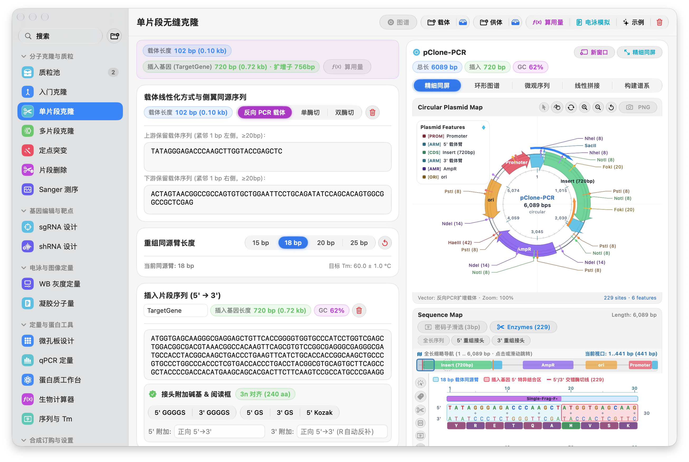
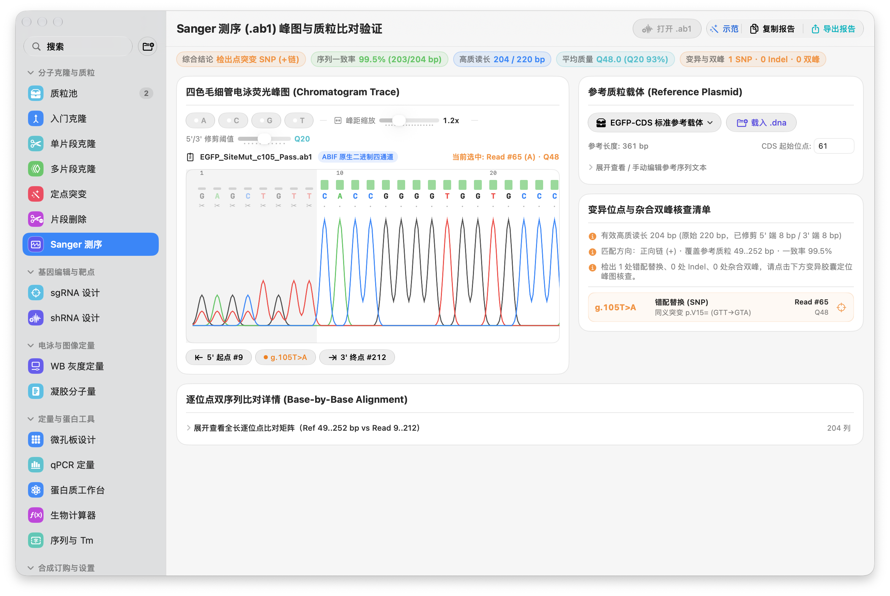
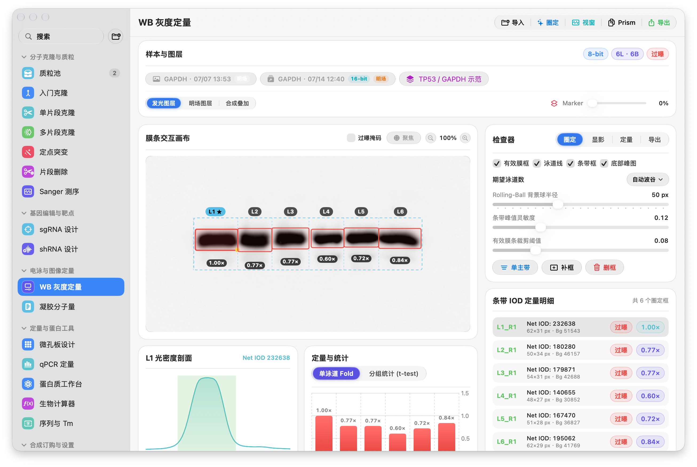
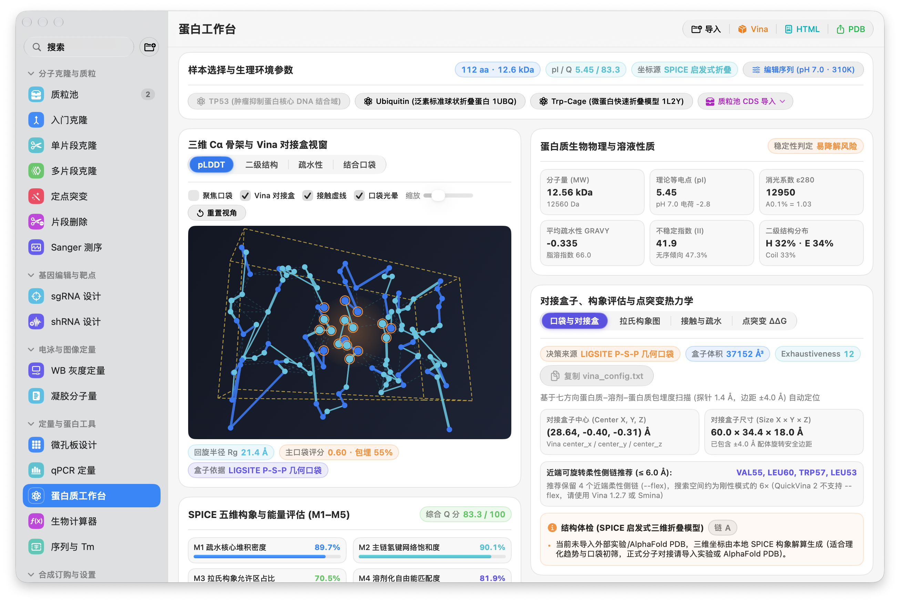
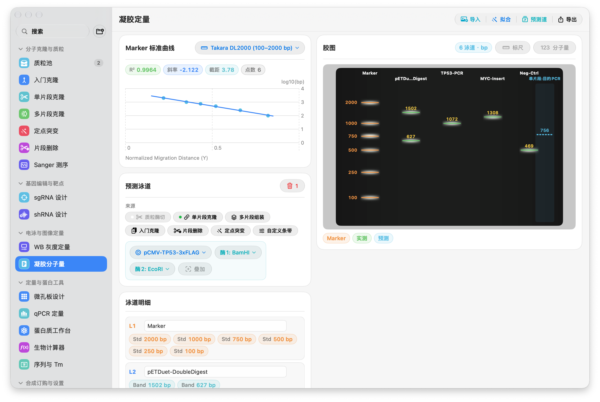
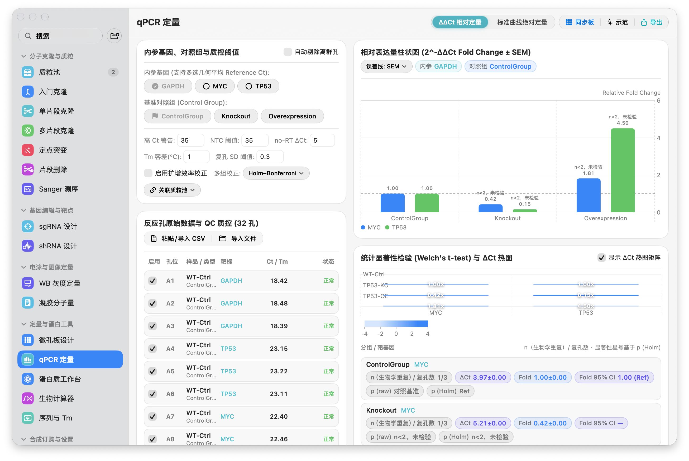
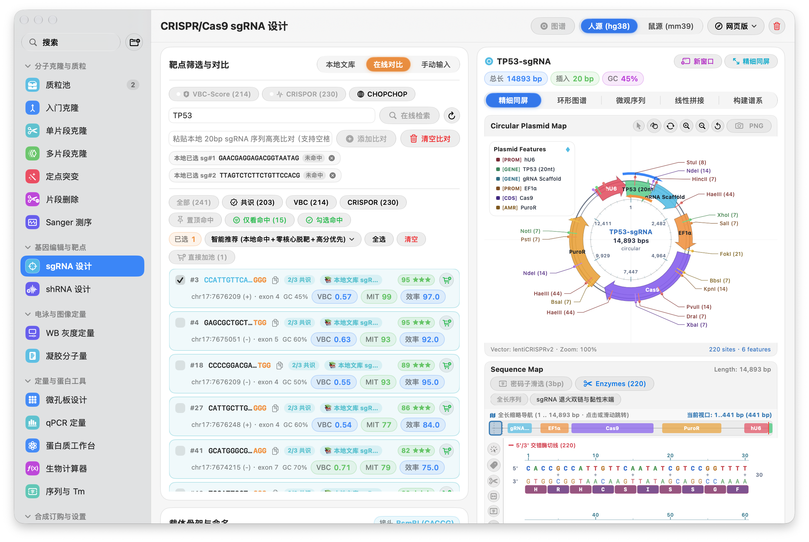

<div align="center">


# Labworker

**专为分子生物学与湿实验科研打造的原生 macOS 全栈工作台**  
*分子克隆引物设计 · 环形质粒与双链图谱 · Sanger 四色峰图 · 16-bit WB / 凝胶 / qPCR 定量 · 三维蛋白口袋与 AI MCP 协同*

[](https://github.com/xin67/Labworker/releases/tag/v20261120)
[](https://github.com/xin67/Labworker/releases/tag/v20261120)
[](#-架构设计与协同工作流)
[](#-ai-智能体协同)
[](LICENSE)

[⬇️ 下载最新版 DMG (`v20261120`)](https://github.com/xin67/Labworker/releases/tag/v20261120) &nbsp;·&nbsp; [🆕 v20261120 最新进展](#-v20261120-最新进展) &nbsp;·&nbsp; [📸 实机界面画廊](#-实机界面与核心能力展示) &nbsp;·&nbsp; [🧩 18 个功能模块](#-18-个全栈功能模块) &nbsp;·&nbsp; [🤖 MCP 智能体接入](#-ai-智能体协同) &nbsp;·&nbsp; [🔧 源码构建](#-安装与源码构建) &nbsp;·&nbsp; [🙏 致谢](#-致谢与参考项目)

<br/>



<sub>▲ 单片段无缝克隆工作台与「精细同屏」双视角预览：左侧设计 15–25 bp 同源重组引物并实时校验 3n 阅读框，右侧同步联动 OVE 环形质粒图谱与双链碱基/氨基酸序列画布（内置公开示例演示）。</sub>

</div>

---

## ✨ 为什么选择 Labworker？

- **🎨 原生 macOS 27 Liquid Glass 体验**：纯 SwiftUI + AppKit 构建，深浅色与系统强调色实时跟随，统一 macOS 系统字体与 `.monospacedDigit()` 等宽数值排版；支持将 `.dna`、`.ab1`、`.tif`、`.pdb` 等文件从 Finder 直接拖入或右键打开自动跳转对应模块。
- **⚡️ 零第三方 Swift 依赖 · 本地硬件加速**：底层完全依托 Apple 原生 `Accelerate/vDSP`、`SQLite3` 与本地计算引擎离线运行——**实验序列与原始图像无需离开本机**。
- **🔬 对齐期刊审稿标准的湿实验统计**：内置 SantaLucia 最近邻 $T_m$ 与二级结构 $\Delta G$ 计算、Rolling-Ball 背景扣减、Welch's *t*-test 及 Holm–Bonferroni 多重检验校正。
- **🤖 开箱即用的 AI MCP 双端协同**：随包内置 `clonestudio_mcp_server.py`（**23** 个工具），可直接接入 Claude Desktop、Cursor、Windsurf、Antigravity 等 AI 客户端，实现自动化引物设计、测序 QC 与工作台联动同步。

---

## 🆕 v20261120 最新进展

- **🧬 核心引擎与 MCP 23 工具扩展**：在 `CloneStudioCore` 与 `labworker-mcp` 服务端新增 **Golden Gate 组装**（基于 `Libraries.sqlite` 中 NEB T4 4-bp 连接保真度矩阵，支持 `BsaI / BsmBI / BbsI / SapI` 2–6 片段零错配接头分配与同义 Domestication）、**诊断性限制酶切推荐**、**离线质粒自动注释**（双链扫描、跨 Origin 拼接与历史残留片段标记）、**HDR 同源修复供体设计**（ssODN/dsDNA、PAM/Seed 同义阻断突变与 Out-Out PCR 引物）及 **CRISPR 编辑池 Sanger NNLS 峰图反卷积**（`Indel%`、`KO Score`、`HDR%` 与拟合优度 $R^2$）。
- **🧪 同源重组 PCR 虚拟电泳与凝胶定量升级**：全部克隆/突变/删除工作台内置实时**同源重组 PCR 凝胶电泳模拟**；`凝胶分子量` 升级支持质粒酶切、单/多片段克隆、入门克隆、片段删除、定点突变与自定义条带多模式虚拟预测道叠加，并优化多泳道标题防重叠排布。
- **🌐 靶点设计内嵌多源在线共识**：移除独立「靶点对比」页签，将在线核验直接嵌入 `sgRNA 设计`（**VBC-Score + UCSC CRISPOR + CHOPCHOP** 三源并发共识评分，修复 `mm39` 与 501 bp 窗口问题）与 `shRNA 设计`（集成 **Broad GPP Public Portal** 官方 TRC 克隆库核验）。
- **🧮 全能生物计算器与 Liquid Glass 细节打磨**：新增**生物计算器**（重组摩尔比配液、dsDNA/ssDNA/Linear/OD260 核酸定量、蛋白摩尔与编码容量、$C_1V_1=C_2V_2$ 溶液配制与温标转换）；移除冗余菌落计数器，收口为 **5 大分类 · 18 个全栈模块**，修复电泳画布横向溢出、Liquid Glass 默认态 HDR 过亮与 WB 切组竞态，全局统一居左紧凑主操作栏与条件性图谱按钮；全部核心算法经 **50 项自动化测试**与 10 组跨语言黄金测试向量验证。

---

## 📸 实机界面与核心能力展示

以下全部截图采集自 **`Labworker v20261120`（macOS 实机浅色 Liquid Glass 主题）** 运行内置公开示范数据的真实界面：

<table>
  <tr>
    <td width="50%" valign="top">
      <a href="docs/images/02-sanger-verify.png">
        
      </a>
      <h4>🧬 Sanger 测序 (<code>.ab1</code>) 四色峰图与突变验证</h4>
      <ul>
        <li>原生解析二进制 <code>ABIF</code> 四通道（<code>A/C/G/T</code>）毛细管电泳峰图与 Phred 质量评分</li>
        <li>支持峰距缩放、<code>5'/3'</code> Q20 质量阈值修剪、环状质粒双向全局比对</li>
        <li>自动检出 SNP 点突变、InDel 与杂合双峰预警，并支持批量克隆验证看板</li>
      </ul>
    </td>
    <td width="50%" valign="top">
      <a href="docs/images/03-western-blot.png">
        
      </a>
      <h4>📊 16-bit Western Blot 灰度定量与明场叠合</h4>
      <ul>
        <li>无损读取原始 <code>16-bit / 8-bit TIFF</code> 化学发光图，支持与明场 Marker 图层叠合</li>
        <li>可调半径 <code>Rolling-Ball</code> 背景扣除、自动切分泳道/条带框与过曝像素掩码高亮</li>
        <li>实时渲染条带光密度剖面峰图、计算内参归一化倍数与统计学显著性报告</li>
      </ul>
    </td>
  </tr>
  <tr>
    <td width="50%" valign="top">
      <a href="docs/images/04-protein-workbench.png">
        
      </a>
      <h4>🧊 三维蛋白骨架、LIGSITE 口袋与 Vina 对接盒</h4>
      <ul>
        <li>三维 Cα 骨架交互视窗，支持按 <code>pLDDT</code>、二级结构、疏水性与结合口袋实时着色</li>
        <li>计算分子量、理论等电点 ($pI$)、消光系数 $\varepsilon_{280}$、GRAVY 与不稳定指数</li>
        <li>七方向 LIGSITE P-S-P 几何扫描定位结合口袋，一键导出 <code>vina_config.txt</code> 与拉氏构象图</li>
      </ul>
    </td>
    <td width="50%" valign="top">
      <a href="docs/images/05-gel-virtual-electrophoresis.png">
        
      </a>
      <h4>🧫 凝胶分子量拟合与多模块虚拟电泳对照</h4>
      <ul>
        <li>自动寻道切分 Marker 条带，基于 $\log_{10}(\text{MW})$ 线性回归标定未知条带片段大小</li>
        <li>支持叠加质粒酶切、单/多片段克隆、入门克隆、片段删除与定点突变虚拟电泳预测道</li>
        <li>内置多种 DNA / 蛋白标准 Ladder 预设，实时评估胶浓度适配性与条带分辨率</li>
      </ul>
    </td>
  </tr>
  <tr>
    <td width="50%" valign="top">
      <a href="docs/images/06-qpcr-analysis.png">
        
      </a>
      <h4>📈 qPCR 荧光定量、QC 质控与 Welch's <i>t</i>-test 多组统计</h4>
      <ul>
        <li>支持 <code>2^(-ΔΔCt)</code> 相对定量与标准曲线绝对定量，具备多内参几何平均与扩增效率校正</li>
        <li>自动排查高 Ct / NTC / no-RT / 熔解曲线偏离与复孔 SD &gt; 0.30 离群风险</li>
        <li>输出 <code>ΔCt</code> 热图矩阵与基于生物学重复级别的 Welch's <i>t</i>-test + Holm–Bonferroni 多组校正</li>
      </ul>
    </td>
    <td width="50%" valign="top">
      <a href="docs/images/07-sgrna-consensus.png">
        
      </a>
      <h4>🎯 CRISPR sgRNA 设计与多源在线共识核验</h4>
      <ul>
        <li>支持本地 <code>Libraries.sqlite</code>（<code>hg38 / mm39</code>）高速离线检索与热力学评分</li>
        <li>内嵌 <strong>VBC-Score + UCSC CRISPOR + CHOPCHOP</strong> 三源并发在线对比与 20bp 共识加分</li>
        <li>一键生成 <code>lentiCRISPRv2</code> (BsmBI) / <code>pX459</code> (BbsI) 退火引物并实时联动重组质粒图谱</li>
      </ul>
    </td>
  </tr>
</table>

---

## 📐 架构设计与协同工作流

```mermaid
flowchart LR
    subgraph Input["📂 多源科研数据输入 (Finder 拖放 / 双击路由)"]
        I1[".dna / .gb / .fasta\n质粒与序列"]
        I2[".ab1 / .abi\nSanger 测序"]
        I3["16-bit .tif / .png\nWB / 凝胶电泳"]
        I4[".pdb / .cif / .csv\n蛋白结构 / qPCR"]
    end

    subgraph Core["⚙️ 原生 Swift 计算内核 (CloneStudioCore · 零第三方依赖)"]
        C1["分子克隆与引物引擎\nSantaLucia Tm · 二聚体/发夹 ΔG"]
        C2["生物图像与峰图引擎\nAccelerate/vDSP · Rolling-Ball · ABIF"]
        C3["结构与统计引擎\nLIGSITE 口袋 · Welch t · Holm 校正"]
        C4["Offline Libraries.sqlite\nhg38 / mm39 离线靶点与酶库"]
    end

    subgraph Surfaces["🖥️ 交互与自动化双端面"]
        S1["macOS 27 Liquid Glass App\n5 大分类 · 18 个功能模块"]
        S2["Python MCP Server\n23 大自动化工具 · 双向同步通道"]
    end

    subgraph Out["📤 学术交付与实验产出"]
        O1["擎科 / 生工标准订购表 (.xlsx)"]
        O2["SnapGene 重组 .dna & Vina 配置"]
        O3["离线 HTML 统计报告 & CSV 数据"]
    end

    Input --> Core
    Core --> S1
    Core <--> S2
    S1 --> Out
    S2 --> Out
```



> 更多工程架构细节与单源真值校验契约，请参阅仓库内部文档：[`labworker/README.md`](labworker/README.md) · [`labworker/ARCHITECTURE.md`](labworker/ARCHITECTURE.md) · [`labworker/HANDOVER.md`](labworker/HANDOVER.md)

---

## 🧩 18 个全栈功能模块

| 分类板块 | 模块名称 | 核心功能与支持格式 |
| :--- | :--- | :--- |
| **分子克隆与质粒 (7)** | `质粒池` / `入门克隆` / `单片段克隆` / `多片段克隆` / `定点突变` / `片段删除` / `Sanger 测序` | `.dna` (SnapGene)、`.gb`、`.fasta`、`.ab1` 解析与导出；支持矢量环形图谱、双链碱基视图、同源重组 PCR 凝胶电泳模拟、3n 移码校验与批量测序看板 |
| **基因编辑与靶点 (2)** | `sgRNA 设计` / `shRNA 设计` | 基于 `Libraries.sqlite`（hg38/mm39）与内嵌在线对比（sgRNA 集成 **VBC-Score + UCSC CRISPOR + CHOPCHOP** 三源共识；shRNA 集成 **Broad GPP Public Portal** 官方 TRC 克隆核验），自动生成带粘性末端的配对引物 |
| **电泳与图像定量 (2)** | `WB 灰度定量` / `凝胶分子量` | 原生 16-bit TIFF 滚球扣背景与显著性柱状图、Ladder $\log_{10}(\text{MW})$ 回归与多模块（质粒酶切/单多片段克隆/入门克隆/片段删除/定点突变/自定义条带）虚拟电泳对照 |
| **定量与蛋白工具 (5)** | `微孔板设计` / `qPCR 定量` / `蛋白工作台` / `生物计算器` / `序列与 Tm` | 96/384 孔防边缘效应排布、$2^{-\Delta\Delta C_t}$ 与标准曲线定量、三维 Cα + LIGSITE 口袋 + Vina 盒 + 点突变 $\Delta\Delta G$；重组 0.03 pmol 摩尔比配液、dsDNA/ssDNA/Linear/OD260 定量、蛋白摩尔/编码容量与 $C_1V_1=C_2V_2$ 溶液换算；SantaLucia 速算 |
| **合成订购与设置 (2)** | `订购中心` / `系统设置` | 擎科 / 生工标准引物与测序 Excel 订购单导出、批量写回 `.dna` 质粒、MCP 服务一键注入与 Liquid Glass 主题/侧边栏定制 |

---

## 🤖 AI 智能体协同

`Labworker.app` 内部打包了开箱即用的 `clonestudio_mcp_server.py`（通过标准 `stdio` MCP 协议提供 **23** 个结构化科研工具），兼容 Claude Desktop、Cursor、Windsurf、Antigravity 与 Codex CLI。

<details>
<summary><b>查看 MCP 客户端接入配置与 23 项内置工具清单</b></summary>

在你的 AI 客户端 MCP 配置文件（例如 `mcp_config.json`）中添加以下配置（安装至 `/Applications/Labworker.app` 后无需额外依赖环境）：

```json
{
  "mcpServers": {
    "labworker-mcp": {
      "command": "/usr/bin/python3",
      "args": [
        "/Applications/Labworker.app/Contents/Resources/clonestudio_mcp_server.py"
      ]
    }
  }
}
```

**23 项可用工具覆盖全流程**：
- **质粒池与序列检索**：`list_plasmid_pool`、`inspect_plasmid`、`add_plasmid_to_pool`、`auto_annotate_sequence`
- **克隆与基因编辑设计**：`design_single_clone_primers`、`design_multi_fragment_primers`、`design_golden_gate_assembly`、`design_mutagenesis_primers`、`design_fragment_deletion_primers`、`calculate_recombination_dosage`、`design_sgrna_primers`、`design_shrna_primers`、`design_hdr_donor`
- **生物换算与溶液配置**：`convert_nucleic_acid_units`、`convert_protein_and_coding`、`calculate_solution_and_temperature`
- **测序、蛋白与湿实验定量**：`verify_sanger_sequencing`、`deconvolute_crispr_sanger`、`analyze_protein_and_docking_box`、`analyze_western_blot`、`analyze_qpcr_ddct`、`design_plate_layout`
- **订购交付**：`manage_primer_cart_and_export`

</details>

---

## 🔧 安装与源码构建

### 方式 A：直接安装发布版 DMG（推荐）

1. 前往 [**GitHub Releases (`v20261120`)**](https://github.com/xin67/Labworker/releases/tag/v20261120) 下载 `Labworker-20261120.dmg`。
2. 双击打开 DMG 镜像，将 `Labworker.app` 拖入 `/Applications` 文件夹。
3. 要求系统环境：**`macOS 27.0` 及以上**。

### 方式 B：从源码编译、打包与回归测试

```bash
git clone https://github.com/xin67/Labworker.git
cd Labworker/labworker

# 1. 运行全部 50 项底层算法与跨语言测试向量（含文档单一真值门禁）
bash Scripts/check_doc_counts.sh

# 2. Release 编译并打包 Labworker.app（自动完成 Ad-hoc 签名校验）
bash Scripts/build_app.sh

# 3. 打包标准可分发 DMG 镜像（输出 Labworker-20261120.dmg 并校验 SHA-256）
bash Scripts/package_dmg.sh
```

> **提示**：仓库已配置 `.gitignore`，所有本地 `.dna` / `.ab1` 序列及私有质粒库记录（`.clonestudio_plasmid_pool.json`）均仅留存于用户本地，不会随代码提交上传。

---

## 🙏 致谢与参考项目

Labworker 在研发与算法对齐过程中学习、参考并集成了以下优秀的开源项目、科学文献与公开生信基础设施，在此向原作者及社区致以诚挚感谢：

### 开源项目与架构参考
- **[TeselaGen / OpenVectorEditor (`tg-oss`)](https://github.com/TeselaGen/tg-oss/tree/main/packages/ove)**（[原独立仓库](https://github.com/TeselaGen/openVectorEditor)）：启发了 Labworker 同心多轨环形质粒图谱（OVE）与双链碱基/氨基酸微观序列画布的极角防碰撞几何布局。
- **[IBN-Spring / DockFlowLab](https://github.com/IBN-Spring/DockFlowLab)**：蛋白质工作台的多模型构象解析规范、LIGSITE 七方向 P-S-P 结合口袋探测、共晶配体共识 AutoDock Vina 对接盒推荐与单文件自包含离线 HTML 报告均深度参考并对齐该项目的工程实现。
- **[libnano / primer3-py](https://github.com/libnano/primer3-py)**：引物二级结构热力学评价引擎（发夹结构 `calc_hairpin`、自二聚体 `calc_homodimer`、异二聚体 `calc_dimer` 与盐离子校正模型）的 $\Delta G$ 与配对拓扑均严格对齐 `primer3-py` 并通过跨语言黄金测试向量验证。
- **[mmcguffi / pLannotate](https://github.com/mmcguffi/pLannotate)**：本地离线未知质粒 FASTA 自动注释引擎（正反双链特征匹配、环形质粒跨零点 Origin 识别与历史残留 Fragment 贪心筛选）参考了 pLannotate 的注释过滤思路。
- **[synthego-open / ice](https://github.com/synthego-open/ice)**：CRISPR 编辑池 Sanger 四色峰图解卷积模块（`deconvolute_crispr_sanger`）参考了 Synthego ICE 的非负最小二乘（NNLS）混杂峰建模思想。
- **[Edinburgh-Genome-Foundry / SnapGeneReader](https://github.com/Edinburgh-Genome-Foundry/SnapGeneReader)**：SnapGene `.dna` 二进制 TLV 区块解析格式参考了社区对 `.dna` 结构的逆向解析规范。

### 学术算法与在线靶点数据库
- **DNA 最近邻热力学模型**：遵循 **SantaLucia & Hicks (2004)** 与 **Bommarito et al. (2000)** 统一最近邻参数及 5'/3' 悬垂端（Dangling Ends）自由能模型。
- **NEB T4 DNA Ligase 4-bp 保真度模型**：Golden Gate 高保真接头分配矩阵参考 **Potapov et al. (2018)** 与 **Pryor et al. (2020)** 的 T4 连接酶错配连接定量研究。
- **在线 CRISPR / RNAi 靶点服务**：
  - **[CHOPCHOP](https://chopchop.cbu.uib.no/)**（[JokingHero/chopchop](https://github.com/JokingHero/chopchop) · Labun et al., *Nucleic Acids Res* 2019）
  - **[VBC-Score](https://www.vbc-score.org/)**（[GMichlits/VBC-Score](https://github.com/GMichlits/VBC-Score) · Michlits et al., *Nature Methods* 2020）
  - **[UCSC CRISPOR](https://crispor.gi.ucsc.edu/)**（[maximilianh/crisporWebsite](https://github.com/maximilianh/crisporWebsite) · Concordet & Haeussler, *Nucleic Acids Res* 2018）
  - **[Broad Institute GPP Public Portal (TRC)](https://portals.broadinstitute.org/gpp/public)**：shRNA 官方 TRC 克隆库与 Adjusted / Intrinsic 效价评分检索。

---

## 📄 开源协议

本项目基于 [MIT License](LICENSE) 开源发布。欢迎提交 Issue 或 Pull Request 共建更好用的原生科研工具链。
